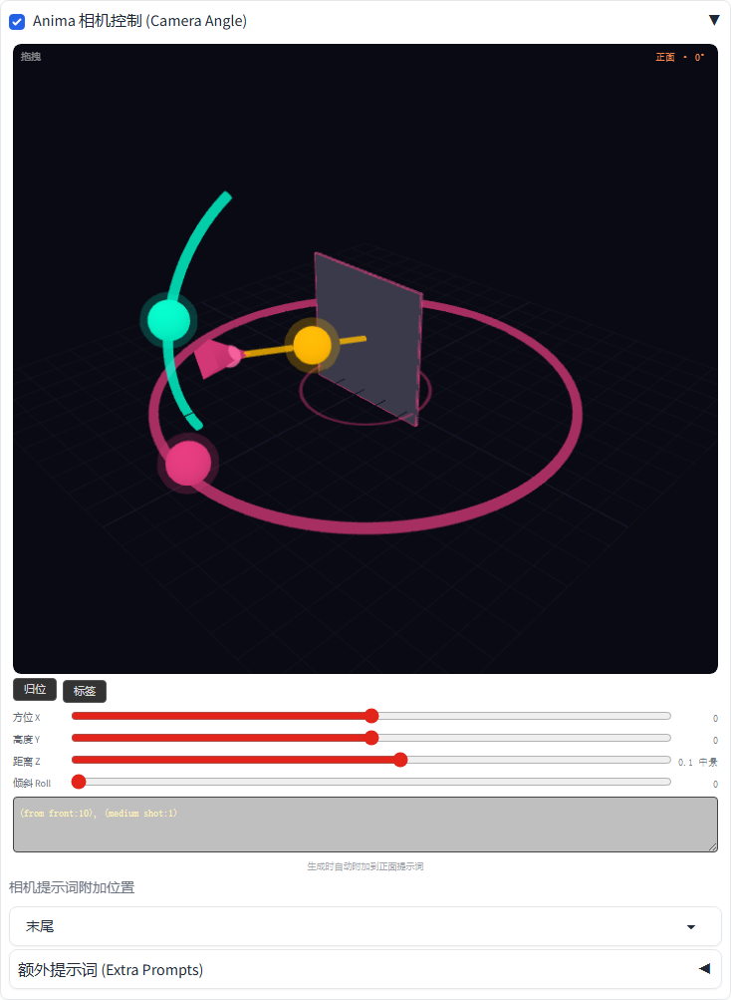
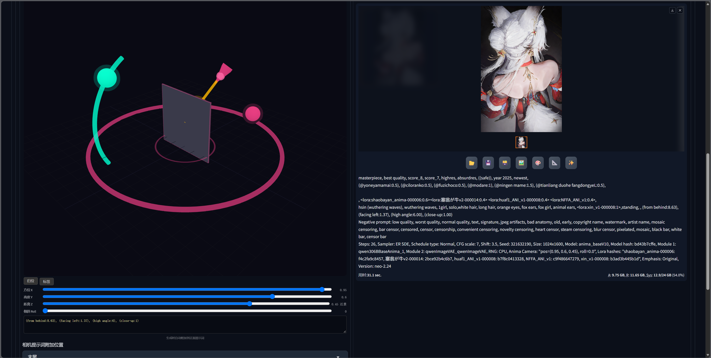
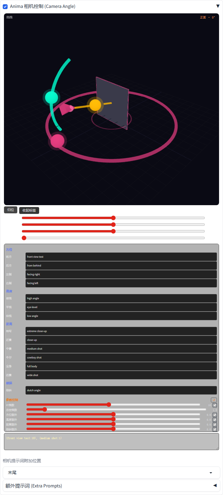

# Anima 相机控制 (Anima Camera Angle) — WebUI 扩展

可视化相机角度控制扩展，适用于 **Stable Diffusion WebUI Forge / A1111**。在 txt2img / img2img 页面内直接拖拽 3D 场景控制相机位置和角度，自动生成结构化的相机提示词并附加到正面提示词。适用于 Anima、Illustrious 等模型。

本项目移植自 ComfyUI 插件 [Comfyui-Anima_camera_angle](https://github.com/xunying7860/Comfyui-Anima_camera_angle)（MIT License，作者 xunying7860），提示词计算算法与原插件完全一致。



## 效果演示

左侧拖拽 3D 控件调整相机（图示：背面 + 俯视 + 近景），右侧直接生成对应视角的图像，生成信息中可见附加的相机提示词：



## 安装

1. 进入 WebUI 的 `extensions` 目录：

```bash
cd stable-diffusion-webui/extensions/   # Forge 同理
git clone https://github.com/wangjue520/sd-webui-anima-camera-angle.git
```

2. 重启 WebUI，在 txt2img / img2img 页面找到 **「Anima 相机控制 (Camera Angle)」** 折叠面板。

无任何额外 Python 依赖（Three.js 已内置，离线可用）。

## 使用

**展开手风琴面板即为启用**（与 ControlNet 等扩展的交互习惯一致），生成时相机会提示词自动附加到正面提示词。

### 3D 场景交互

- **拖拽** 紫色圆环上的粉色点 → 调整方位角（前/后/左/右）
- **拖拽** 青色弧上的青色点 → 调整高度（俯视/平视/仰视）
- **拖拽** 黄色点，或在画布上 **滚动滚轮** → 调整距离（特写/近景/中景/牛仔/全身/远景，6 档）
- 下方滑条可进行精确数值微调（方位 X / 高度 Y / 距离 Z / 倾斜 Roll）
- **归位** 按钮复位视角，**标签** 按钮展开标签编辑面板

### 标签面板

可编辑各视角的提示词文案（方位/高度/距离/倾斜），并调节权重参数：

| 参数 | 范围 | 默认 | 说明 |
| --- | --- | --- | --- |
| XY 乘数 | 1~20 | 开启，值=10 | 同时控制方位和高度权重基数 |
| 总控乘数 | 0.1~10 | 1 | 各轴额外权重的总乘数 |
| 方位/高度/距离/倾斜 额外 | -10~10 | 0 | 各轴权重加成，行末复选框可整体启用/禁用该轴 |

### 额外提示词

可附加极限角度（极限俯视/极限仰视，互斥单选）、镜头、景深、运镜、构图、风格等提示词。



## 输出示例

默认状态（正面 · 平视 · 中景）输出：

```
(from front:10.00), (medium shot:1.00)
```

右侧 90° + 俯视 + 特写：

```
(facing left:10.00), (high angle:5.00), (extreme close-up:1.00)
```

## 重要：权重调节建议

提示词权重通过 `(tag:权重)` 语法实现。不同模型/后端对大权重的耐受度不同：

- 如果出图出现**噪点、伪影、过饱和**，打开「标签 → 参数控制」把 **XY 乘数降到 1~3**
- 使用 Illustrious 模型时，正前/后方视角建议 XY 乘数不超过 2，其余不超过 3
- 使用 Anima（Qwen 文本编码器）模型时建议从 **2** 开始尝试

## 其他说明

- 相机参数会写入 PNG 信息（infotext），从图片信息页回填时可自动恢复
- 支持 Hires fix（高清修复阶段的提示词会同步附加）
- 支持 API 调用（`alwayson_scripts` 中的 `"Anima 相机控制"`）
- txt2img 与 img2img 页签相互独立

## 致谢

- 原 ComfyUI 插件：[Comfyui-Anima_camera_angle](https://github.com/xunying7860/Comfyui-Anima_camera_angle) by xunying7860
- 内置 [Three.js](https://threejs.org/) r167（MIT License）

## License

MIT
